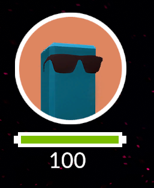
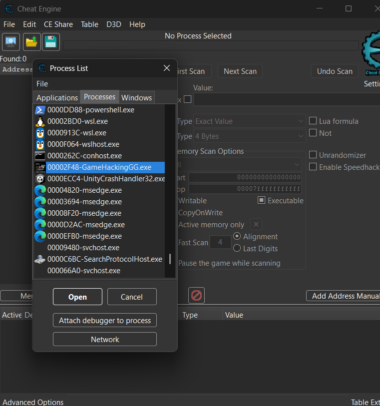
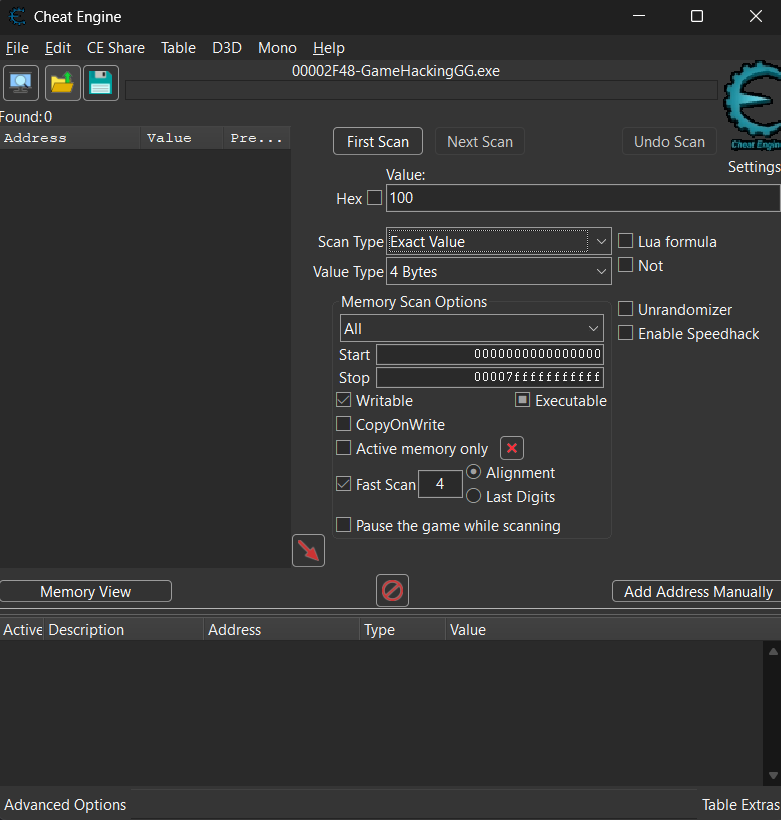
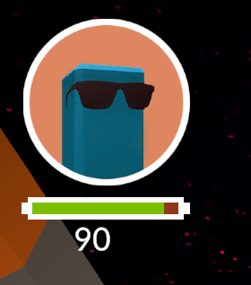
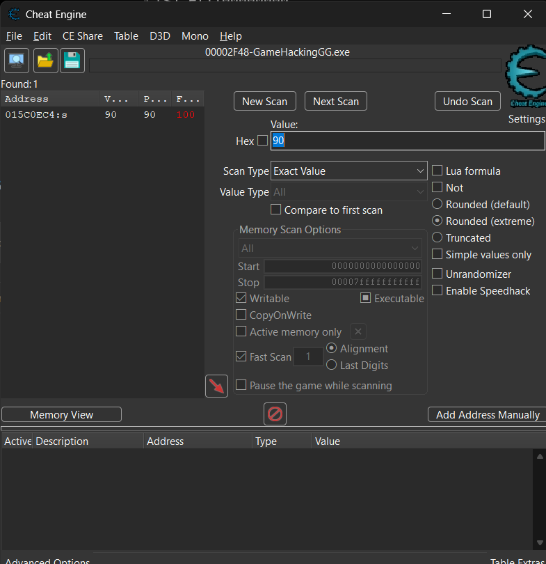
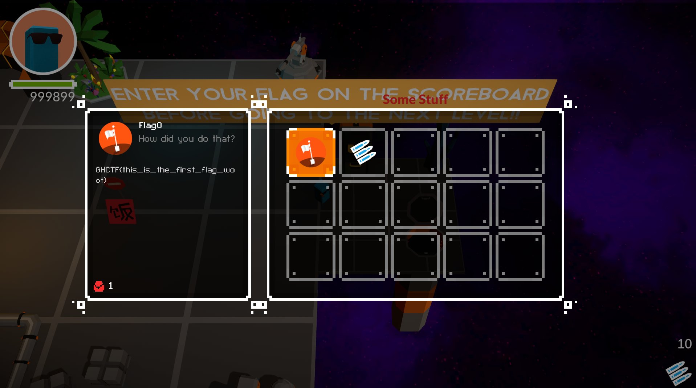

# Level 1

## Nhiệm vụ

-- Phá hủy **khối băng** bằng cách chạm vào nó 
-- Sau khi thử chơi, chúng ta thấy được là máu của người chơi sẽ ít hơn máu của khối băng

## Hướng giải
-- Sử dụng `Cheat Engine` để chỉnh thông số của game qua các bước sau: ( vì đây là level 1 nên mình sẽ đi chi tiết nhé, về sau sẽ không nói thêm)

-- Đầu tiên, xác định thông số cần chỉnh, ở đây là `100 HP`

-- Bước hai, bật `Cheat engine` --> File --> Process List --> GamehackinGG.exe --> Open

-- Bước ba, nhập giá trị `100`, vì mình biết chính xác giá trị nên chọn `Scan type = exact value` , `Value type= All`, sau đó bấm first scan để scan lần đầu tiên

-- Bước 4, sau khi đã scan xong, nếu xuất hiện nhiều địa chỉ khác nhau thì chúng ta phải khoanh vùng địa chỉ chứa `HP` bằng cách cho nhân vật mình bị mất máu 1-2 lần rồi bấm `Next scan` cho đến khi chỉ còn chứa 1 địa chỉ offset là giá trị `HP`

-- Đây chính là offset chứa giá trị thanh HP, sửa thành giá trị xxxxx và tận hưởng thôi

--> Flag: GHCTF{this_is_the_first_flag_woot}
