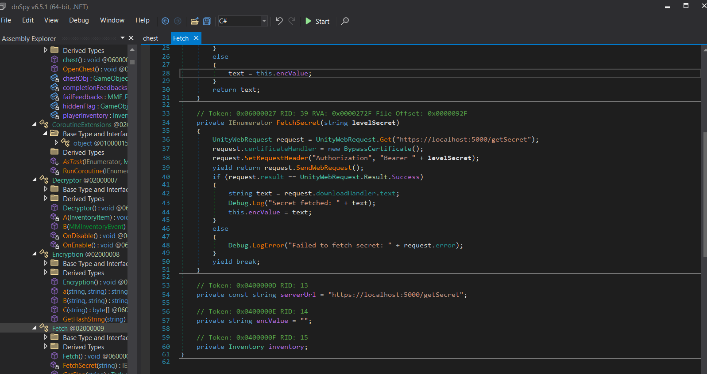
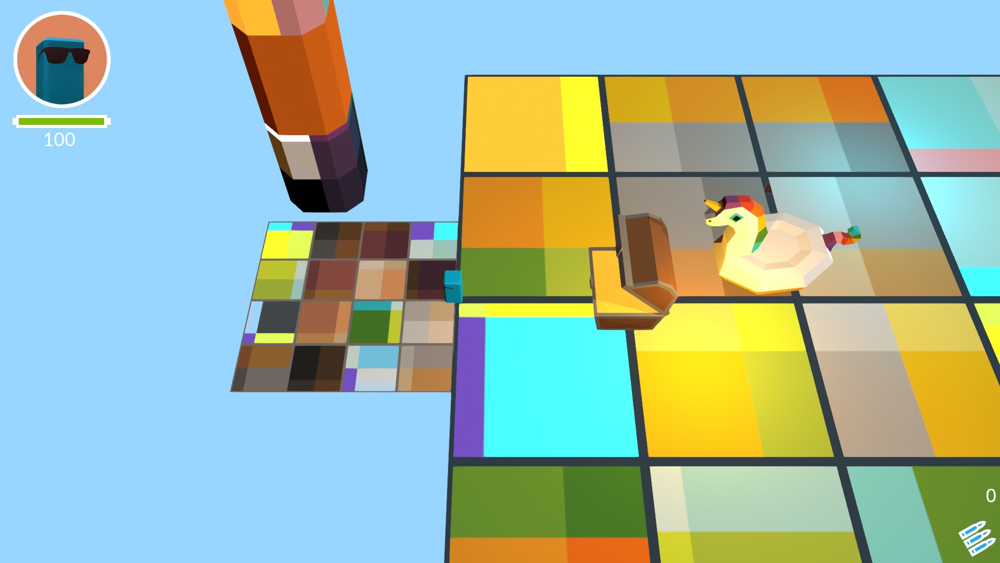
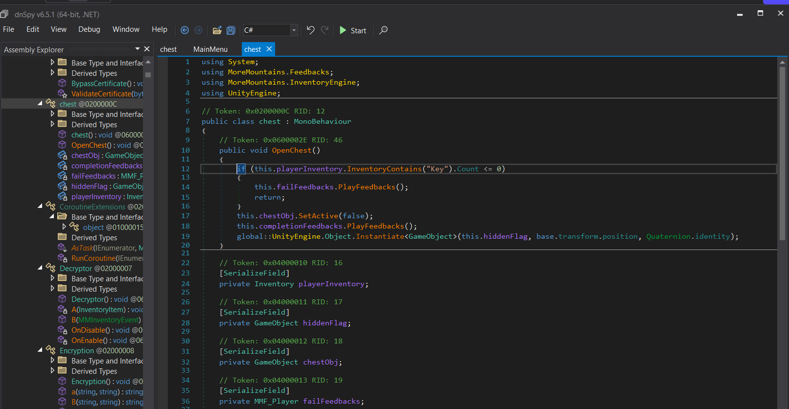
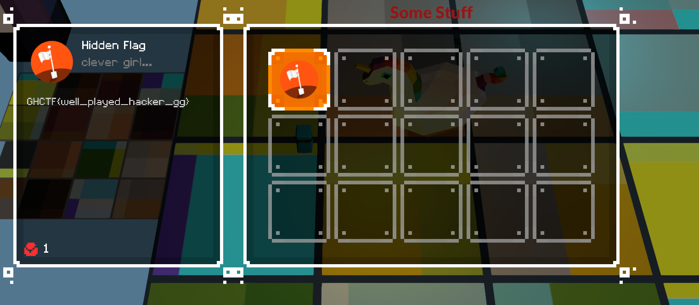

# Level 10 (secret)
## Nhiệm vụ 
-- Đơn giản chỉ cần mở rương bị khóa với key thôi
## Hướng giải
-- Ban đầu mình tìm được 1 hàm `chest` nên sau khi giải hết 9 level thì mình mới bắt đầu hoài nghi
-- Lục 1 hồi thì mình tìm được hàm `fetch` chứa dấu hiệu khả nghi

```clike=
public async Task<string> GetFlag(string levelSecret)
{
    await this.FetchSecret(levelSecret).AsTask(this);
    string text;
    if (this.encValue == "")
    {
        Debug.LogError("Error getting secret from server");
        text = "";
    }
    else
    {
        text = this.encValue;
    }
    return text;
}
```
-- Thấy rằng, hàm này nhận dữ liệu từ `levelSecret`,rồi gọi server lấy dữ liệu. Nếu lấy được thì trả về encValue, không được thì trả chuỗi rỗng ""
-- Mình suy nghĩ chắc là do `main menu` ẩn đi cái level cuối nên mình tàm luôn hàm `main menu` thử và thấy được hàm `Loadlevel`
--> Mình dùng GPT để hỗ trợ thì code đơn giản chỉnh như sau:
```
public void LoadLevel(int level)
	{
		if (level == 1){
			SceneManager.LoadScene(10);
		} else {
		SceneManager.LoadScene(level);
		}
	}
```
--> Nếu như trong mục `main menu` mình nhấn `level 1` thì lập tức sẽ chuyển mình qua màn `level10`, thử nhé





-- Vào được map `secret ` luôn, bây giờ nhiệm vụ của mình là qua hàm `chest` để chỉnh xíu lấy flag nhé

-- bỏ đi `return` thôi là có được flag

--> Flag:GHCTF{well_played_hacker_gg}
