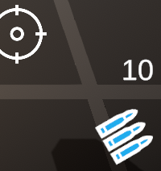
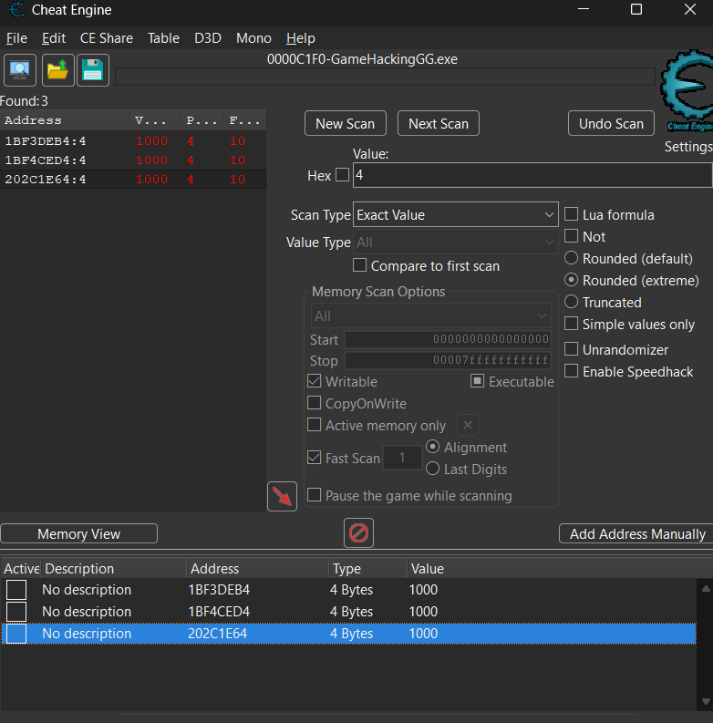
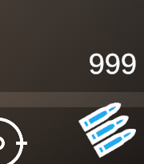
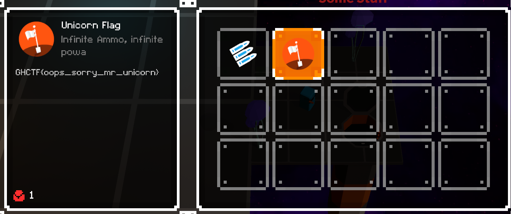

# Level 2

## Nhiệm vụ
- Ở level 2 này , chúng ta cần phải tiêu diệt con ngựa bằng khẩu súng ở màn 1, tuy nhiên 10 viên đạn là không đủ :v, thế thì chỉnh như ở level 1 thôi

## Hướng giải
-- Tìm offset chứa giá trị viên đạn, ở đây game cho chúng ta 10 viên đạn
 
-- Bắn từng viên 1 để tra ra offset và thay đổi giá trị thôi(nhớ là phải scan 10 viên trước rồi mới bắn nhé)
-- Nếu không thu hẹp được 1 offset thì chúng ta có thể thử gán giá trị cho tất cả các offset nhé
 
-- Thành công:

-> Flag: GHCTF{oops_sorry_mr_unicorn}
