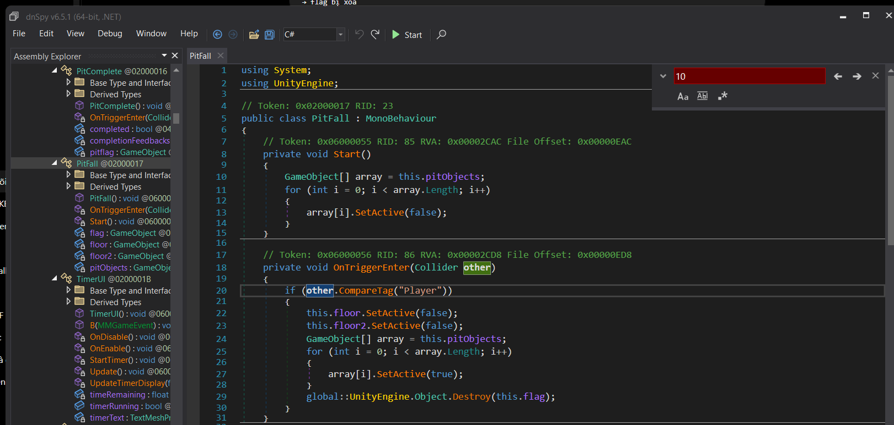
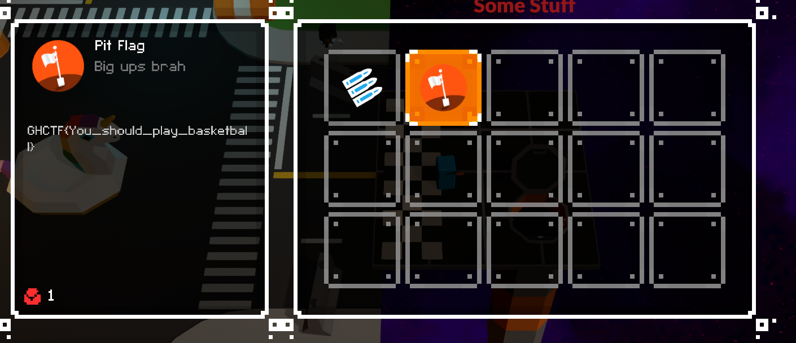

# Level 4

## Nhiệm vụ
- Ở màn này, chúng ta cần phải tìm được cách để nhảy lên thoát khỏi cái hố là lấy được flag
## Hướng giải
-- Bật `DnSpy` và thay đổi 1 chút code nhé:
-- Thông thường để có thể xem và thay đổi dữ liệu của game, chúng ta thường tìm kiếm file `Assembly-Csharp.dll` vì đây là nơi lưu trữ hầu hết các data của game
-- Tìm đến hàm `Pitfall` của game:

```clike=
if (other.CompareTag("Player"))
    {
        this.floor.SetActive(false);
        this.floor2.SetActive(false);
        GameObject[] array = this.pitObjects;
        for (int i = 0; i < array.Length; i++)
        {
            array[i].SetActive(true);
        }
        global::UnityEngine.Object.Destroy(this.flag);
    }
```
--> Một khi player chạm vào mặt đất thì `this.floor.SetActive(false)` và `this.floor2.SetActive(false)` . 2 câu lệnh dẫn đến mặt đất bị mất làm mình rớt xuống
-- Để sửa code nhấp chuột phải và chọn Edit class:
```clike=
private void OnTriggerEnter(Collider other)
{
    if (other.CompareTag("Player"))
    {
        
        return;
    }
 ``` 
-- File --> Save Module --> Ok để lưu file mới
--> Sau khi player chạm vào sàn thì flag cũng như sàn sẽ không biến mất 

--> Flag: GHCTF{You_should_play_basketball}
