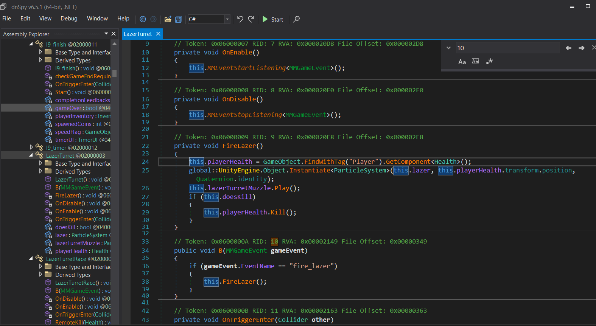
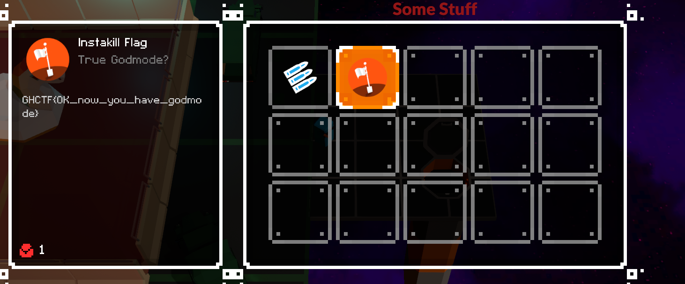

# Level 5

## Nhiệm vụ
-- Ở level này, chúng ta cần phải lấy flag trong cái base của boss
-- Nhưng mỗi khi đi vào chạm vùng đỏ(base boss) thì sẽ bị turret bắn chết
## Hướng giải
-- Bật `Dnspy` tìm hàm `LazerTurret` 

-- Dễ thấy, 2 hàm `FireLazer` và `B` là 2 hàm khiến chúng ta bị bắn. Nhưng thật chất chỉ cần chỉnh hàm `FireLazer` là được
-- Sửa code:
```clike=
using System;
using MoreMountains.Tools;
using MoreMountains.TopDownEngine;
using UnityEngine;

// Token: 0x02000003 RID: 3
public partial class LazerTurret : MonoBehaviour, MMEventListener<MMGameEvent>, MMEventListenerBase
{
	// Token: 0x06000009 RID: 9 RVA: 0x000020E8 File Offset: 0x000002E8
	private void FireLazer()
	{
		return;// Tắt hết các hiệu ứng, không kill player
	}
}
```

--> Flag: GHCTF{OK_now_you_have_godmode}
