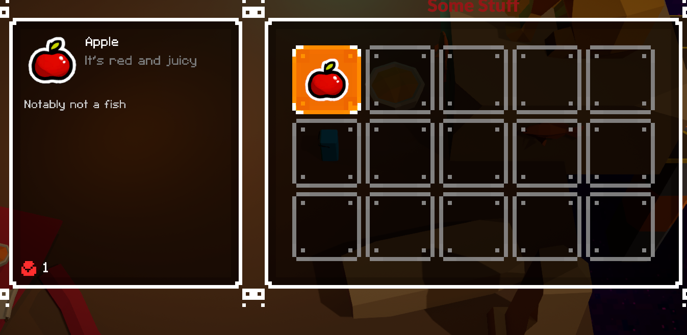
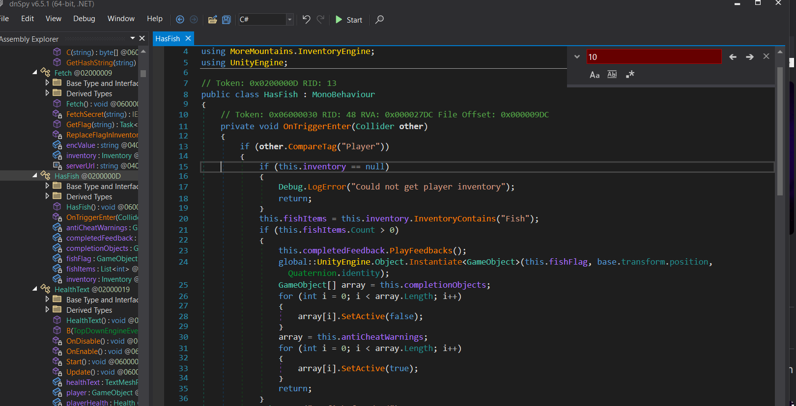
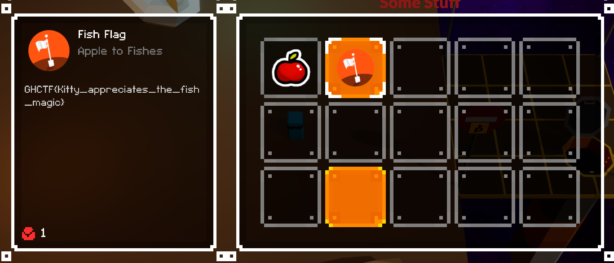

# Level 6

## Nhiệm vụ
-- Giao 1 con cá cho thần mèo để có flag nhưng mà game lại cho mình 1 quả táo :v 

## Hướng giải
-- Bật `DnSpy` và tìm đến hàm `HasFish`

```clike=
if (this.fishItems.Count > 0){
        this.completedFeedback.PlayFeedbacks();
        global::UnityEngine.Object.Instantiate<GameObject>(this.fishFlag, base.transform.position, Quaternion.identity);
        GameObject[] array = this.completionObjects;
        for (int i = 0; i < array.Length; i++)
        {
            array[i].SetActive(false);
        }
        array = this.antiCheatWarnings;
        for (int i = 0; i < array.Length; i++)
        {
            array[i].SetActive(true);
        }
        return;
        }
```
--> Dễ thấy nếu như chúng ta có hơn 1 con cá thì thần mèo sẻ nhả flag cho chúng ta :V
-- Sửa code:
```clike=
if (this.fishItems.Count >= 0)
```

--> Flag: GHCTF{Kitty_appreciates_the_fish_magic}
