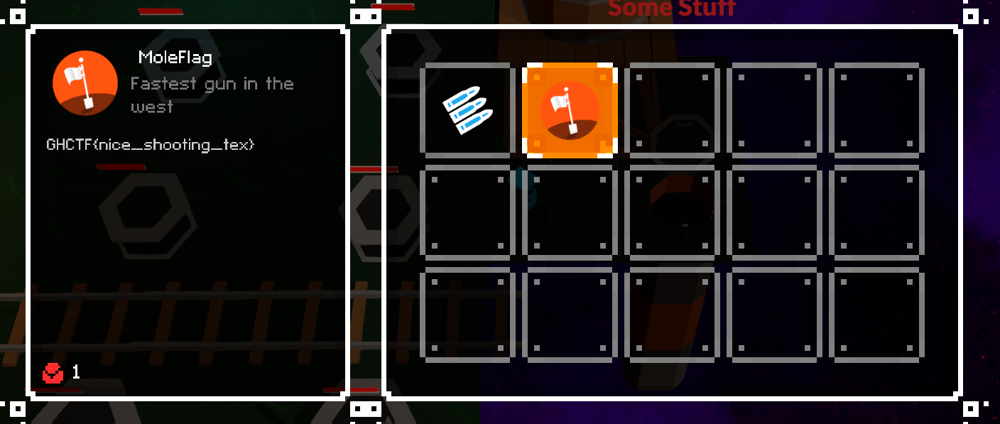

# Level 7

## Nhiệm vụ
-- Nhiệm vụ của chúng ta cần phải bắn hết tất cả chuột chũi trong vòng 10s, và điều này là không thể.
## Hướng giải
-- Bật `Dnspy` và tìm kiếm hàm `wackamole`, sau đó tìm hàm `CheckWin`
```clike=
private bool CheckWin()
	{
		Debug.Log(string.Format("{0}:{1}", this.spawnCount, this.killCount));
		if (this.spawnCount == this.killCount && this.spawnCount != 0)
		{
			this.completionFeedback.PlayFeedbacks();
			global::UnityEngine.Object.Instantiate<GameObject>(this.moleFlag, base.transform.position, Quaternion.identity);
			return true;
		}
		this.shootingFeedback.PlayFeedbacks();
		base.StartCoroutine(this.WaitDelay(0.5f));
		this.playerHealth.Kill();
		return false;
   }
```   
--> Điều kiện để chiến thắng là cần phải tiêu diệt đủ số chuột chũi đồng thời số chuột chũi sinh ra >0, vậy chỉ cần chỉnh lại số lượt tiêu diệt = số lượt spawn chuột chũi  là được
```clike=
private bool CheckWin()
	{
		Debug.Log(string.Format("{0}:{1}", this.spawnCount, this.killCount));
		this.spawnCount = 1;
		this.killCount = this.spawnCount;
		if (this.killCount == this.spawnCount && this.spawnCount != 0)
		{
			this.completionFeedback.PlayFeedbacks();
			global::UnityEngine.Object.Instantiate<GameObject>(this.moleFlag, base.transform.position, Quaternion.identity);
			return true;
		}
		this.shootingFeedback.PlayFeedbacks();
		base.StartCoroutine(this.WaitDelay(0.5f));
		return false;
	}
```
-- Sau đó chúng ta chỉ cần đứng yên 10s là sẽ qua màn

--> Flag: GHCTF{nice_shooting_tex}
