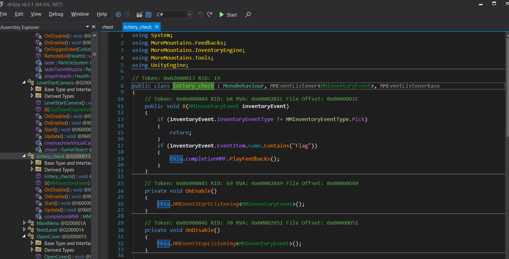
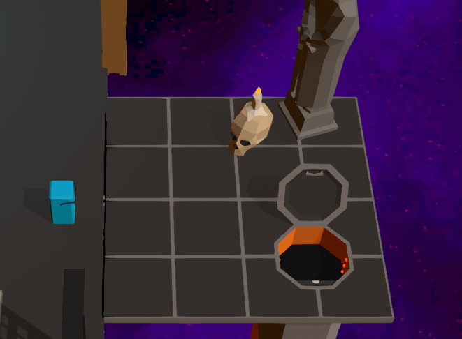

# Level 8

## Nhiệm vụ
-- Cần phải mở 1 cái rương đang bị khóa để có flag
## Hướng giải
-- Bật `Dnspy`, tìm đến hàm `Lottery_check`

-- Nói ngắn gọn chỉ cần nhặt cho đến khi nào xuất hiện ra được flag, nhưng vì để pass level thì mình có thể sửa như sau:
```clike=
public void B(MMInventoryEvent inventoryEvent)
	{
		if (inventoryEvent.InventoryEventType != MMInventoryEventType.Pick)
		{
			return;
		}
		this.completionMMF.PlayFeedbacks();
	}
```
-- Điều này nghĩa là nếu mình nhặt bất kì item nào thì nó cũng sẽ coi nó như `flag` và bypass thành công


