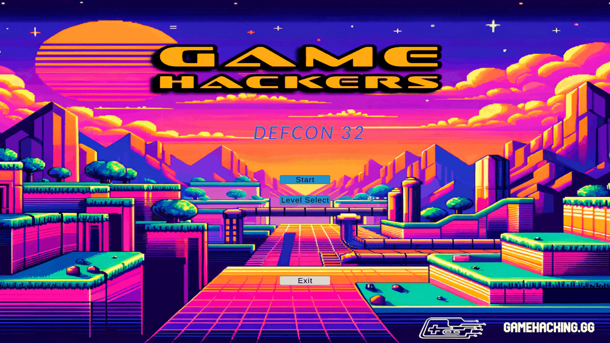

# DEFCON 32 (GameHackingVillage CTF 2024)
---

-- Tổng quan: Đây là một challenge khá thú vị về Game Hacking, được tạo vào năm 2024. Tuy đã cũ, nhưng challenge này vẫn là nền tảng tốt để mình luyện tập thêm về reverse engineering cũng như các kỹ năng liên quan đến game hacking
-- Đồng thời, challenge này mình sẽ sử dụng chủ yếu 2 ứng dụng phổ biến để điều chỉnh thông số cũng như code đó là `Dnspy` và `Cheat Engine`
-- Game gồm có 10 levels (từ cơ bản đến nâng cao), 9 levels bình thường và 1 level secret, bắt đầu vào từng challenge nhé

## Các level

- [Level 1](Level%201/README.md)
- [Level 2](Level%202/README.md)
- [Level 3](Level%203/README.md)
- [Level 4](Level%204/README.md)
- [Level 5](Level%205/README.md)
- [Level 6](Level%206/README.md)
- [Level 7](Level%207/README.md)
- [Level 8](Level%208/README.md)
- [Level 9](Level%209/README.md)
- [Level 10 (secret)](Level%2010%20%28secret%29/README.md)
